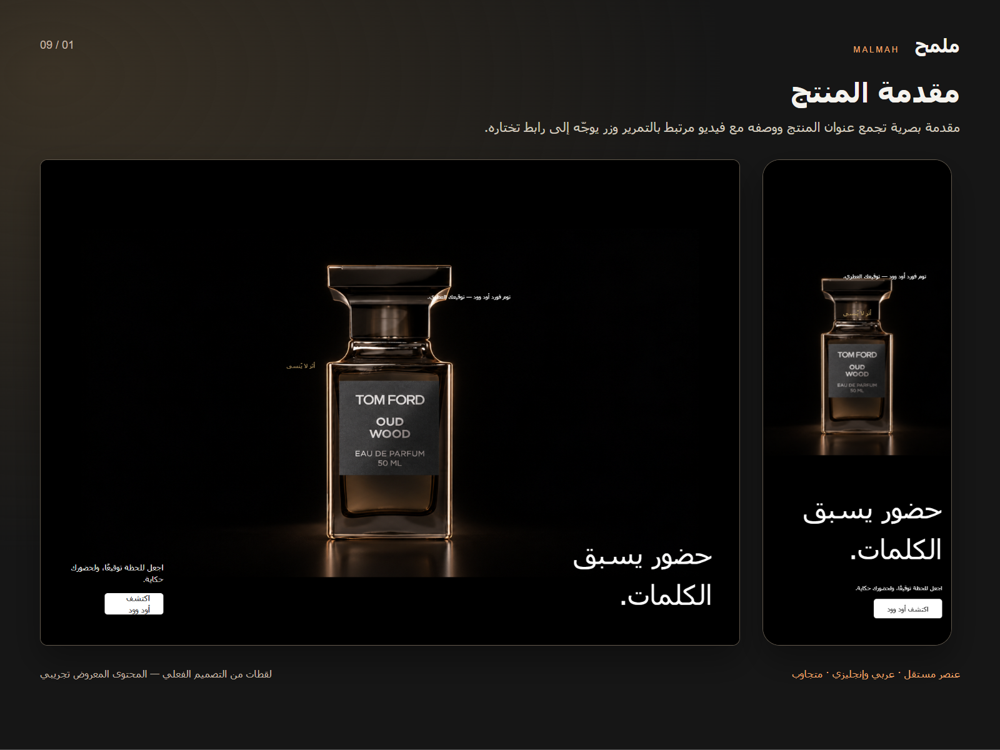
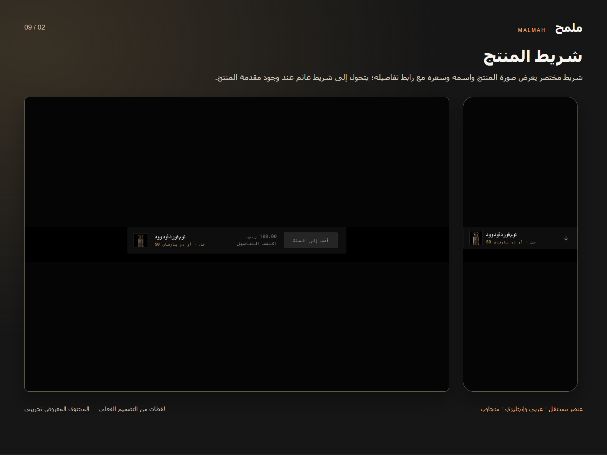
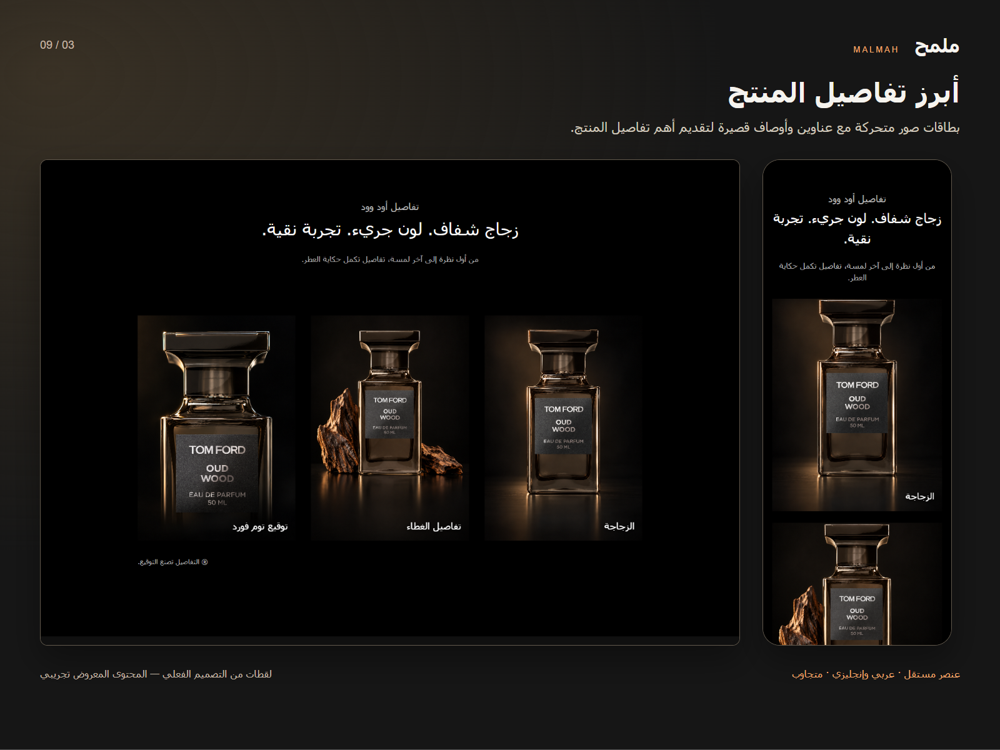
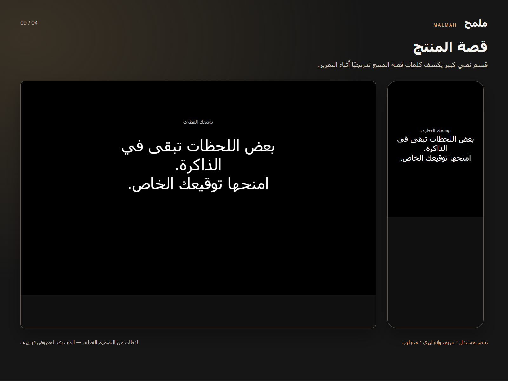
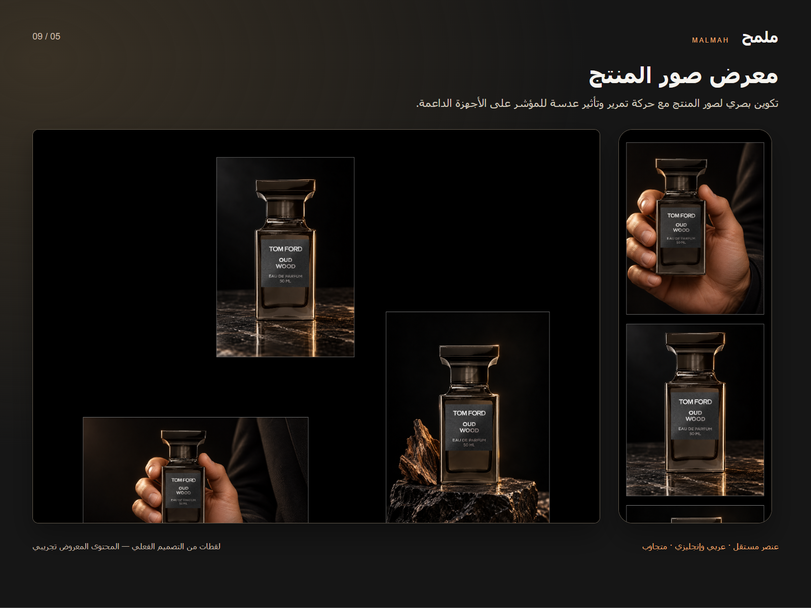
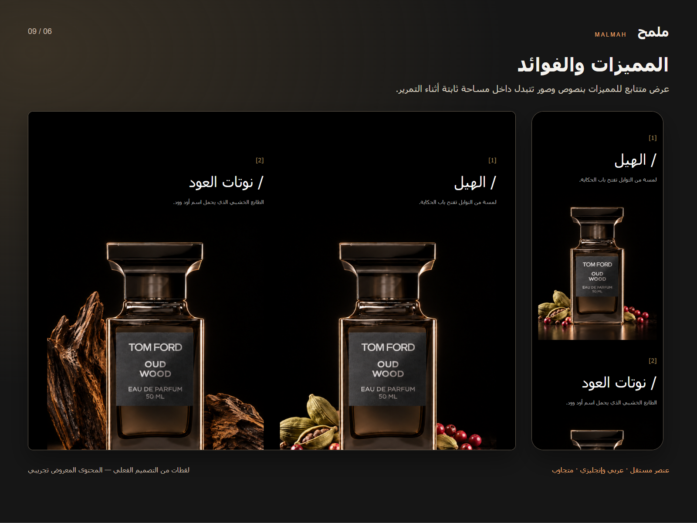
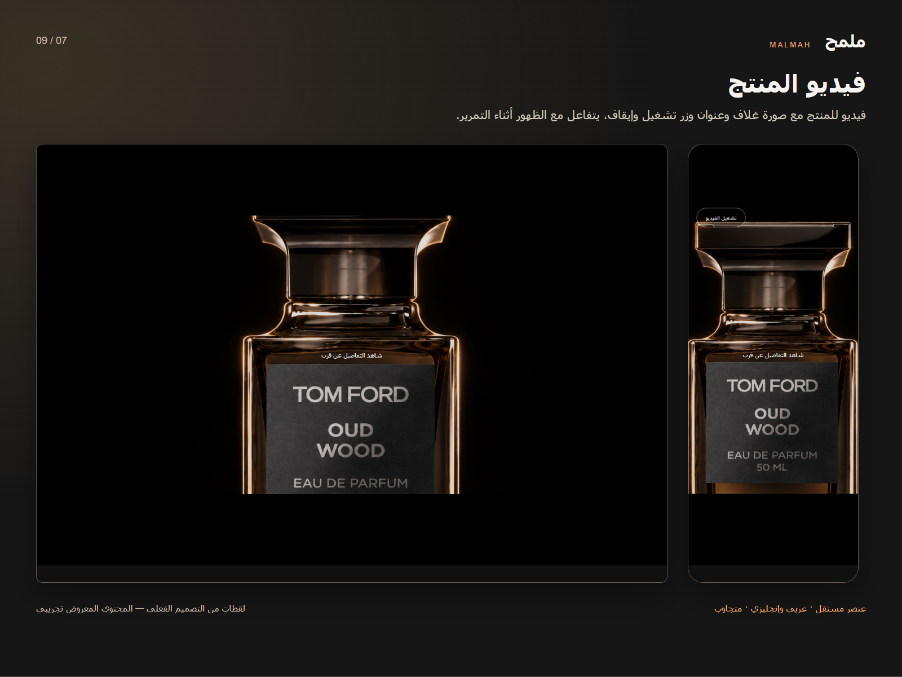
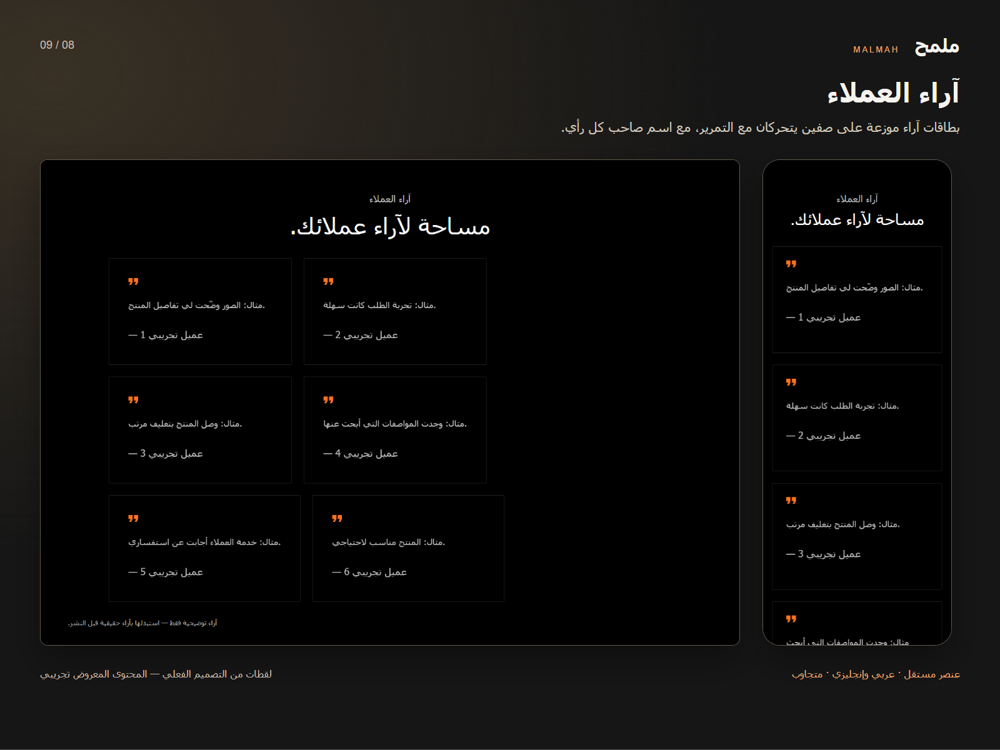
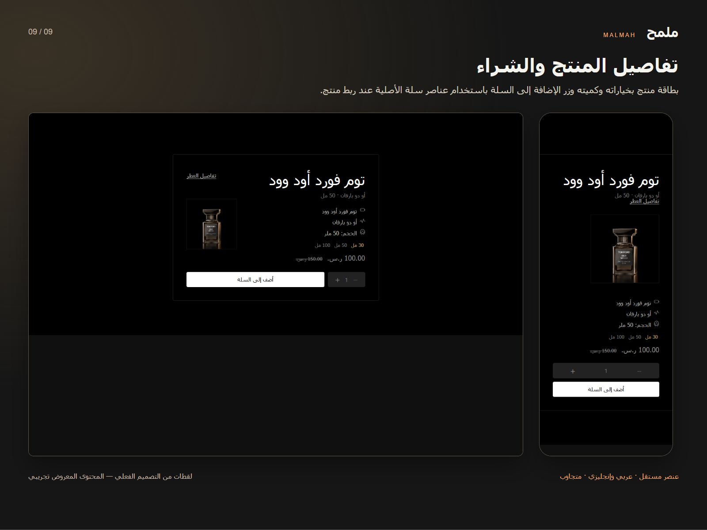

# ملمح — دليل الاستخدام

مجموعة من تسعة عناصر مستقلة لعرض تفاصيل المنتجات. تضيف العناصر داخل ثيم متجرك؛ لا تتضمن صفحة هبوط أو هيدرًا أو فوترًا.

## البدء

1. ثبّت المجموعة على متجرك من واجهة سلة بعد إتاحتها لك.
2. افتح تخصيص الثيم، ثم أضف العنصر المطلوب من قائمة العناصر. قد تختلف تسمية القوائم حسب الثيم.
3. افتح إعدادات العنصر، واستبدل المحتوى التجريبي بمحتوى متجرك.
4. عدّل النصوص لكل من AR وEN. الصور والفيديوهات والألوان ومعرّفات الأقسام مشتركة بين اللغتين.
5. احفظ وعاين على الجوال والحاسوب، ثم تحقّق من الروابط والشراء قبل إظهار التغييرات للعملاء.

## إعدادات مشتركة

- يمكنك استخدام أي عنصر منفردًا، أو ترتيب عدة عناصر حسب حاجة متجرك. لا يوجد ترتيب إلزامي.
- روابط الوسائط يجب أن تكون HTTPS عامة ودائمة. المسارات من جهازك أو localhost أو /demo-uploads/ لا تصلح للمتجر.
- استخدم صورًا وفيديوهات تملك حقوق استخدامها. الصور والآراء الافتراضية للمعاينة ويجب استبدالها.
- استعمل ألوانًا ذات تباين واضح. اتجاه النص يتكيف مع العربية والإنجليزية. العناصر تحترم تقليل الحركة في نظام الزائر.
- اختيار المنتج مستقل لكل عنصر. إذا استخدمت الشريط وبطاقة الشراء لنفس المنتج، اختره في كل منهما صراحةً.
- كل زر له قسم مستهدف ينتقل إليه إن وجد، ثم يستخدم الرابط المستقل عند غيابه. عند عدم توفر مقصد صالح يختفي رابط الإجراء.

## مقدمة المنتج

مقدمة بصرية تجمع عنوان المنتج ووصفه مع فيديو مرتبط بالتمرير وزر يوجّه إلى رابط تختاره.

### طريقة الاستخدام

1. اكتب عنوانًا قصيرًا ووصفًا يشرحان قيمة المنتج، ثم عدّل النص العلوي والنص المميز.
2. أضف رابط فيديو مباشر وصورة غلاف بديلة.
3. اكتب نص الزر وضع رابط المنتج أو الوجهة في «رابط الزر المستقل». يمكنك استخدام «معرف قسم الشراء» إذا أضفت قسمًا مستهدفًا في نفس الصفحة.
4. اختبر الزر والمقدمة على الجوال. زر اكتشاف المزيد يظهر فقط عند وجود عنصر أبرز التفاصيل.

**الوسائط المناسبة:** فيديو أفقي بنسبة تقارب 16:9 وصورة غلاف بنفس النسبة؛ اترك مساحة حول المنتج لأن التكوين يتغير على الجوال.

**الاستخدام المستقل:** يعمل منفردًا. عند غياب القسم المستهدف يستخدم الرابط المستقل، ويختفي الزر إن لم يوجد أي مقصد صالح.

### الإعدادات

| الحقل | طريقة الاستخدام | اللغة |
| --- | --- | --- |
| العنوان | عنوان العنصر الظاهر للزائر. اجعله قصيرًا ومعبّرًا. | عربي / إنجليزي |
| النص العلوي | نص داعم قصير أعلى المقدمة. | عربي / إنجليزي |
| النص المميز | عبارة قصيرة بلون التمييز. | عربي / إنجليزي |
| الوصف | وصف مختصر يشرح المنتج أو الفائدة. | عربي / إنجليزي |
| نص زر الشراء | النص الظاهر على الزر. | عربي / إنجليزي |
| معرف قسم الشراء | معرف قسم موجود في نفس الصفحة، بدون #؛ الرابط المستقل بديل عند غيابه. | مشترك |
| رابط الزر المستقل | رابط HTTPS أو مسار يبدأ بـ / داخل المتجر. يُستخدم إذا لم يوجد القسم المستهدف. | مشترك |
| نص التمرير | نص رابط المزيد؛ يظهر عندما يوجد عنصر أبرز تفاصيل المنتج في الصفحة. | عربي / إنجليزي |
| رابط الفيديو | رابط HTTPS مباشر لملف فيديو قابل للتشغيل في المتصفح، وليس صفحة مشاركة أو تحميل. | مشترك |
| صورة غلاف الفيديو | صورة تظهر قبل تحميل الفيديو أو عند تعذر تشغيله. | مشترك |
| لون الخلفية | لون خلفية العنصر فقط. | مشترك |
| لون النص | لون النص. راجع التباين مع الخلفية. | مشترك |
| اللون المميز | لون التمييز والروابط وحالات التركيز. | مشترك |

## شريط المنتج

شريط مختصر يعرض صورة المنتج واسمه وسعره مع رابط تفاصيله؛ يتحول إلى شريط عائم عند وجود مقدمة المنتج.

### طريقة الاستخدام

1. اختر المنتج من حقل «المنتج من المتجر» لجلب الاسم والصورة والسعر الحقيقي.
2. عدّل نص عرض التفاصيل ونص الزر.
3. ضع «رابط المنتج المستقل» أو استخدم رابط المنتج الذي تجلبه سلة. معرف القسم المستهدف اختياري للانتقال داخل نفس الصفحة.
4. عند استخدامه منفردًا يظهر في موضعه الطبيعي. مع المقدمة يظهر عائمًا بعد تجاوزها، ويختفي قرب قسم الشراء إن وجد.

**الوسائط المناسبة:** صورة المنتج من سلة هي الأصل عند ربط منتج. صورة المعاينة المربعة والاسم والسعر التجريبي تستخدم عند غياب الربط فقط.

**الاستخدام المستقل:** لا يحتاج إلى مقدمة أو قسم شراء. الرابط اليدوي ثم رابط المنتج الحقيقي بدائل عند غياب القسم المستهدف. لا ينفذ إضافة مباشرة للسلة.

### الإعدادات

| الحقل | طريقة الاستخدام | اللغة |
| --- | --- | --- |
| اسم المنتج للمعاينة | اسم تجريبي يظهر قبل اختيار منتج؛ عند الربط يُستخدم اسم المنتج الحقيقي. | عربي / إنجليزي |
| نص عرض التفاصيل | نص رابط تفاصيل المنتج. | عربي / إنجليزي |
| نص زر الشراء | النص الظاهر على الزر. | عربي / إنجليزي |
| معرف القسم المستهدف | معرف القسم المستهدف داخل الصفحة. لا يلزم إضافته عند استخدام رابط مستقل أو رابط منتج سلة. | مشترك |
| رابط المنتج المستقل | رابط تفاصيل المنتج؛ عند غياب القسم المستهدف تكون له الأولوية على رابط المنتج القادم من سلة. | مشترك |
| الصورة | رابط صورة عامة عبر HTTPS؛ راجع اقتراحات الصور الخاصة بالعنصر. | مشترك |
| السعر التجريبي | سعر للمعاينة فقط. عند ربط منتج يُستخدم سعره الحقيقي. | عربي / إنجليزي |
| الألوان التجريبية | وصف ألوان تجريبي يُخفى عند ربط منتج حقيقي. | عربي / إنجليزي |
| المنتج من المتجر | اختر منتجًا فعليًا من متجرك؛ لا تكتب الرابط أو الاسم بدلًا من الاختيار. | مشترك |
| لون الخلفية | لون خلفية العنصر فقط. | مشترك |
| لون النص | لون النص. راجع التباين مع الخلفية. | مشترك |
| اللون المميز | لون التمييز والروابط وحالات التركيز. | مشترك |

## أبرز تفاصيل المنتج

بطاقات صور متحركة مع عناوين وأوصاف قصيرة لتقديم أهم تفاصيل المنتج.

### طريقة الاستخدام

1. عدّل العنوان الصغير والعنوان والوصف والنص الختامي.
2. افتح قائمة العناصر وعدّل صورة وعنوان ووصف كل بطاقة.
3. استخدم ثلاثة تفاصيل مختصرة وصورًا متناسقة، ثم راجع ترتيبها في الجوال.

**الوسائط المناسبة:** صور واضحة عالية الجودة، متقاربة النسب؛ يفضّل 1200 بكسل للضلع الأطول مع ترك التفاصيل المهمة قرب الوسط.

**الاستخدام المستقل:** يعمل منفردًا ولا يحتاج إلى ربط منتج أو عنصر آخر.

### الإعدادات

| الحقل | طريقة الاستخدام | اللغة |
| --- | --- | --- |
| العنوان الصغير | عنوان صغير يمهّد للمحتوى. | عربي / إنجليزي |
| العنوان | عنوان العنصر الظاهر للزائر. اجعله قصيرًا ومعبّرًا. | عربي / إنجليزي |
| الوصف | وصف مختصر يشرح المنتج أو الفائدة. | عربي / إنجليزي |
| النص الختامي | عبارة ختامية قصيرة. | عربي / إنجليزي |
| العناصر | قائمة محتوى العنصر. أضف أو احذف أو رتّب العناصر من المحرر، ثم عدّل الحقول الداخلية أدناه. | مشترك |
| العناصر ← العنوان | عنوان العنصر الظاهر للزائر. اجعله قصيرًا ومعبّرًا. | عربي / إنجليزي |
| العناصر ← الصورة | رابط صورة عامة عبر HTTPS؛ راجع اقتراحات الصور الخاصة بالعنصر. | مشترك |
| لون الخلفية | لون خلفية العنصر فقط. | مشترك |
| لون النص | لون النص. راجع التباين مع الخلفية. | مشترك |
| اللون المميز | لون التمييز والروابط وحالات التركيز. | مشترك |

## قصة المنتج

قسم نصي كبير يكشف كلمات قصة المنتج تدريجيًا أثناء التمرير.

### طريقة الاستخدام

1. اكتب عنوانًا صغيرًا يوضح موضوع القصة.
2. اكتب قصة قصيرة في حقل النص؛ يظهر تأثير الكشف على الكلمات تلقائيًا.
3. اضبط الألوان بحيث يظل النص مقروءًا، وراجع العربية والإنجليزية.

**الوسائط المناسبة:** لا يحتاج إلى صور أو صوت. اسم الملف البرمجي القديم sound لا يعني وجود مشغّل صوت.

**الاستخدام المستقل:** عنصر نصي مستقل بالكامل. مع تقليل الحركة تظهر الكلمات دون حركة تدريجية.

### الإعدادات

| الحقل | طريقة الاستخدام | اللغة |
| --- | --- | --- |
| العنوان الصغير | عنوان صغير يمهّد للمحتوى. | عربي / إنجليزي |
| النص | النص الأساسي؛ لا يحتاج إلى HTML. | عربي / إنجليزي |
| لون الخلفية | لون خلفية العنصر فقط. | مشترك |
| لون النص | لون النص. راجع التباين مع الخلفية. | مشترك |
| اللون المميز | لون التمييز والروابط وحالات التركيز. | مشترك |

## معرض صور المنتج

تكوين بصري لصور المنتج مع حركة تمرير وتأثير عدسة للمؤشر على الأجهزة الداعمة.

### طريقة الاستخدام

1. اكتب وصفًا للقسم.
2. أضف أو عدّل الصور الثلاث في قائمة الصور، واكتب وصفًا بديلًا يشرح كل صورة.
3. راجع قص الصور وترتيبها على الجوال والحاسوب، وضع التفاصيل المهمة وسط الصورة.

**الوسائط المناسبة:** ثلاث صور بتفاصيل واضحة؛ يفضّل صور أصلية بعرض 1200 بكسل على الأقل مع ضغط مناسب.

**الاستخدام المستقل:** لا يعتمد على عنصر آخر. عند عدم دعم تأثير العدسة تبقى الصورة الأساسية ظاهرة.

### الإعدادات

| الحقل | طريقة الاستخدام | اللغة |
| --- | --- | --- |
| وصف القسم | وصف واضح للقسم ويساعد على التعرف عليه. | عربي / إنجليزي |
| الصور | قائمة الصور. عدّل كل صورة ووصفها البديل. | مشترك |
| الصور ← الصورة | رابط صورة عامة عبر HTTPS؛ راجع اقتراحات الصور الخاصة بالعنصر. | مشترك |
| الصور ← وصف الصورة | وصف بديل يشرح الصورة لقارئ الشاشة، وليس اسم ملف الصورة. | عربي / إنجليزي |
| لون الخلفية | لون خلفية العنصر فقط. | مشترك |
| لون النص | لون النص. راجع التباين مع الخلفية. | مشترك |
| اللون المميز | لون التمييز والروابط وحالات التركيز. | مشترك |

## المميزات والفوائد

عرض متتابع للمميزات بنصوص وصور تتبدل داخل مساحة ثابتة أثناء التمرير.

### طريقة الاستخدام

1. اكتب وصف القسم وحدد الصورة الافتتاحية.
2. عدّل قائمة المميزات: عنوان الميزة ووصفها وصورتها.
3. استخدم فائدة محددة لكل ميزة، ثم اختبر تبديل الصور أثناء التمرير على الجوال والحاسوب.

**الوسائط المناسبة:** صورة افتتاحية وصورة لكل ميزة؛ استخدم نسبًا متقاربة وتجنب كتابة نصوص أساسية داخل الصور.

**الاستخدام المستقل:** يعمل منفردًا. الحركة داخل العنصر فقط ولا تتطلب وجود المقدمة أو المعرض.

### الإعدادات

| الحقل | طريقة الاستخدام | اللغة |
| --- | --- | --- |
| وصف القسم | وصف واضح للقسم ويساعد على التعرف عليه. | عربي / إنجليزي |
| الصورة الافتتاحية | الصورة المعروضة قبل بدء تسلسل المميزات. | مشترك |
| العناصر | قائمة محتوى العنصر. أضف أو احذف أو رتّب العناصر من المحرر، ثم عدّل الحقول الداخلية أدناه. | مشترك |
| العناصر ← العنوان | عنوان العنصر الظاهر للزائر. اجعله قصيرًا ومعبّرًا. | عربي / إنجليزي |
| العناصر ← الوصف | وصف مختصر يشرح المنتج أو الفائدة. | عربي / إنجليزي |
| العناصر ← الصورة | رابط صورة عامة عبر HTTPS؛ راجع اقتراحات الصور الخاصة بالعنصر. | مشترك |
| لون الخلفية | لون خلفية العنصر فقط. | مشترك |
| لون النص | لون النص. راجع التباين مع الخلفية. | مشترك |
| اللون المميز | لون التمييز والروابط وحالات التركيز. | مشترك |

## فيديو المنتج

فيديو للمنتج مع صورة غلاف وعنوان وزر تشغيل وإيقاف، يتفاعل مع الظهور أثناء التمرير.

### طريقة الاستخدام

1. ضع رابط ملف فيديو مباشر، وليس رابط صفحة YouTube أو صفحة تحميل.
2. أضف صورة الغلاف وعدّل العنوان ونصي التشغيل والإيقاف.
3. اختبر زر التشغيل والإيقاف وإمكانية فتح الرابط على جهاز آخر. الفيديو مكتوم افتراضيًا.

**الوسائط المناسبة:** ملف MP4 متوافق مع المتصفحات وصورة غلاف أفقية بنسبة 16:9. استخدم استضافة HTTPS مستقرة وملفًا مضغوطًا.

**الاستخدام المستقل:** يعمل منفردًا، ويحترم تفضيل تقليل الحركة. لا تضف معلومة أساسية في الصوت فقط.

### الإعدادات

| الحقل | طريقة الاستخدام | اللغة |
| --- | --- | --- |
| العنوان | عنوان العنصر الظاهر للزائر. اجعله قصيرًا ومعبّرًا. | عربي / إنجليزي |
| رابط الفيديو | رابط HTTPS مباشر لملف فيديو قابل للتشغيل في المتصفح، وليس صفحة مشاركة أو تحميل. | مشترك |
| صورة غلاف الفيديو | صورة تظهر قبل تحميل الفيديو أو عند تعذر تشغيله. | مشترك |
| نص تشغيل الفيديو | نص زر تشغيل الفيديو. | عربي / إنجليزي |
| نص إيقاف الفيديو | نص زر إيقاف الفيديو. | عربي / إنجليزي |
| لون الخلفية | لون خلفية العنصر فقط. | مشترك |
| لون النص | لون النص. راجع التباين مع الخلفية. | مشترك |
| اللون المميز | لون التمييز والروابط وحالات التركيز. | مشترك |

## آراء العملاء

بطاقات آراء موزعة على صفين يتحركان مع التمرير، مع اسم صاحب كل رأي.

### طريقة الاستخدام

1. عدّل العنوان الصغير والعنوان والنص الختامي.
2. أدخل نص كل رأي واسم صاحبه في قائمة العناصر.
3. استبدل الآراء التجريبية بآراء حقيقية لديك إذن باستخدامها. هذه بطاقات تحرير يدوي وليست مزامنة لتقييمات سلة.

**الوسائط المناسبة:** لا يحتاج إلى صور. استخدم آراء قصيرة ومقروءة بلا بيانات شخصية غير مصرح بعرضها.

**الاستخدام المستقل:** مستقل ولا يجلب تقييمات المنتجات تلقائيًا. حركة الصفين تتوقف عند تفعيل تقليل الحركة.

### الإعدادات

| الحقل | طريقة الاستخدام | اللغة |
| --- | --- | --- |
| العنوان الصغير | عنوان صغير يمهّد للمحتوى. | عربي / إنجليزي |
| العنوان | عنوان العنصر الظاهر للزائر. اجعله قصيرًا ومعبّرًا. | عربي / إنجليزي |
| النص الختامي | عبارة ختامية قصيرة. | عربي / إنجليزي |
| العناصر | قائمة محتوى العنصر. أضف أو احذف أو رتّب العناصر من المحرر، ثم عدّل الحقول الداخلية أدناه. | مشترك |
| العناصر ← الرأي | رأي حقيقي مصرح بعرضه؛ استبدل النص التجريبي. | عربي / إنجليزي |
| العناصر ← الاسم | اسم صاحب الرأي بموافقته. | عربي / إنجليزي |
| لون الخلفية | لون خلفية العنصر فقط. | مشترك |
| لون النص | لون النص. راجع التباين مع الخلفية. | مشترك |
| اللون المميز | لون التمييز والروابط وحالات التركيز. | مشترك |

## تفاصيل المنتج والشراء

بطاقة منتج بخياراته وكميته وزر الإضافة إلى السلة باستخدام عناصر سلة الأصلية عند ربط منتج.

### طريقة الاستخدام

1. اختر منتجًا فعليًا من حقل «المنتج من المتجر».
2. عدّل الوصف التسويقي والمواصفات وعناوينها؛ الاسم والسعر والصور والخيارات الحقيقية تأتي من المنتج المختار.
3. افتح نافذة المواصفات وراجع محتواها باللغتين.
4. اختبر منتجًا بخيارات مطلوبة وآخر نافد المخزون، ثم اختر الخيارات والكمية وأضف للسلة على متجر تجريبي.

**الوسائط المناسبة:** صور المنتج من سلة عند الربط. الألوان والصور والأسعار التجريبية للمعاينة فقط وليست بديلًا عن اختيار منتج حقيقي.

**الاستخدام المستقل:** يعمل منفردًا ولا يحتاج إلى شريط المنتج أو المقدمة. على المتجر زر الشراء معطل إذا لم تختَر منتجًا؛ السلة المحلية التجريبية لا تثبت نجاح شراء فعلي.

### الإعدادات

| الحقل | طريقة الاستخدام | اللغة |
| --- | --- | --- |
| اسم المنتج للمعاينة | اسم تجريبي يظهر قبل اختيار منتج؛ عند الربط يُستخدم اسم المنتج الحقيقي. | عربي / إنجليزي |
| الوصف | وصف مختصر يشرح المنتج أو الفائدة. | عربي / إنجليزي |
| عنوان المواصفات | عنوان المواصفات المختصرة. | عربي / إنجليزي |
| المواصفات | المواصفات المختصرة التي تظهر في البطاقة. | مشترك |
| المواصفات ← النص | النص الأساسي؛ لا يحتاج إلى HTML. | عربي / إنجليزي |
| عنوان الألوان | عنوان خيارات الألوان التجريبية. | عربي / إنجليزي |
| السعر التجريبي | سعر للمعاينة فقط. عند ربط منتج يُستخدم سعره الحقيقي. | عربي / إنجليزي |
| نص زر الشراء | النص الظاهر على الزر. | عربي / إنجليزي |
| عنوان الكمية | اسم حقل الكمية لقارئ الشاشة. | عربي / إنجليزي |
| رسالة المعاينة | رسالة توضّح أن الإضافة التجريبية لا تمثل شراءً فعليًا. | عربي / إنجليزي |
| رسالة التحميل | رسالة انتظار جلب المنتج. | عربي / إنجليزي |
| رسالة الخطأ | رسالة تعذر تحميل المنتج. | عربي / إنجليزي |
| المنتج من المتجر | اختر منتجًا فعليًا من متجرك؛ لا تكتب الرابط أو الاسم بدلًا من الاختيار. | مشترك |
| الألوان والصور التجريبية | صور وأسماء ألوان تجريبية تُستخدم عند غياب ربط المنتج. | مشترك |
| الألوان والصور التجريبية ← الاسم | اسم اللون التجريبي. | عربي / إنجليزي |
| الألوان والصور التجريبية ← اللون | لون عينة المعاينة. | مشترك |
| الألوان والصور التجريبية ← الصورة | رابط صورة عامة عبر HTTPS؛ راجع اقتراحات الصور الخاصة بالعنصر. | مشترك |
| لون الخلفية | لون خلفية العنصر فقط. | مشترك |
| لون النص | لون النص. راجع التباين مع الخلفية. | مشترك |
| اللون المميز | لون التمييز والروابط وحالات التركيز. | مشترك |
| عنوان نافذة المواصفات | عنوان نافذة المواصفات. | عربي / إنجليزي |
| زر إغلاق المواصفات | نص إغلاق النافذة. | عربي / إنجليزي |
| المواصفات التفصيلية | مجموعات المواصفات داخل النافذة. عدّل عنوان ونص كل مجموعة. | مشترك |
| المواصفات التفصيلية ← عنوان القسم | عنوان العنصر الظاهر للزائر. اجعله قصيرًا ومعبّرًا. | عربي / إنجليزي |
| المواصفات التفصيلية ← المحتوى: الاسم ／ القيمة، وسطر فارغ بين المجموعات | نص المواصفة؛ سطر جديد لكل بند. استخدم الصيغة: اسم البند ／ قيمته لعرض عمودين. | عربي / إنجليزي |
| رسالة المنتج الوهمي | رسالة ضرورة اختيار منتج حقيقي قبل تفعيل الشراء على المتجر. | عربي / إنجليزي |
| نص نفاد المخزون | نص نفاد المخزون. | عربي / إنجليزي |

## حل المشكلات

| المشكلة | الإجراء |
| --- | --- |
| الصورة لا تظهر | افتح رابط الصورة في نافذة خاصة وتأكد من HTTPS وأنه رابط الصورة نفسها. |
| الفيديو لا يعمل | استخدم MP4 مباشرًا، واختبر الرابط دون تسجيل دخول، وراجع صورة الغلاف. |
| زر المقدمة أو الشريط غير ظاهر | أضف رابطًا مستقلًا صالحًا، أو قسمًا موجودًا بالمعرف المحدد. الشريط يمكنه استخدام رابط منتج سلة بعد اختياره. |
| بيانات المنتج لا تظهر | تأكد من اختيار منتج منشور ومتاح في كل عنصر، ثم جرّب تحديث المعاينة. |
| الإضافة إلى السلة معطلة | اختر منتجًا فعليًا، واستكمل خياراته المطلوبة، وراجع المخزون والكمية. |
| حركة العنصر متوقفة | تحقق من إعداد تقليل الحركة في الجهاز؛ التوقف في هذه الحالة مقصود. |
| التعديل لا يظهر في اللغة الأخرى | عدّل نفس الحقل من تبويب اللغة الأخرى واحفظ. |

## اختبار قبل النشر

اختبر كل عنصر منفردًا في الثيم، العربية والإنجليزية، الجوال والحاسوب، لوحة المفاتيح وتقليل الحركة. لعنصر الشراء اختبر الخيارات المطلوبة والسعر والكمية والمخزون والإضافة إلى السلة. المعاينة المحلية لا تنفذ عملية شراء حقيقية.

## الدعم

البريد: shahienms30@gmail.com

الموقع: https://mohamed-shahien.online

عند طلب المساعدة أرسل اسم العنصر، خطوات إعادة المشكلة، المتصفح وحجم الشاشة، وصورة توضّح المشكلة. لا ترسل كلمات المرور أو مفاتيح المتجر.
